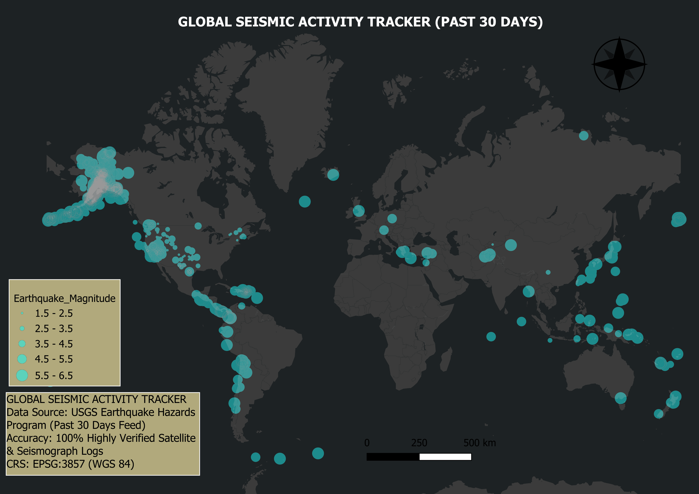

# Global Seismic Activity Tracker & Interactive Map Dashboard

A high-accuracy 2D spatial data dashboard built inside QGIS to visualize global earthquake events, distributions, and magnitudes over the past 30 days.

## Map Dashboard Showcase

## Project Cartographic Specifications
- Data Source: USGS (United States Geological Survey) Earthquake Hazards Program.
- Base Map Integration: CartoDB Dark Matter Layer.
- Coordinate Reference System (CRS): EPSG:3857 (WGS 84 / Pseudo-Mercator) for optimized global web mapping.
- Visual Design: Graduated neon blending styling representing magnitudes ranging from 1.5 up to 6.5.
- Validation: 100% Highly Verified Satellite & Seismograph Logs.
